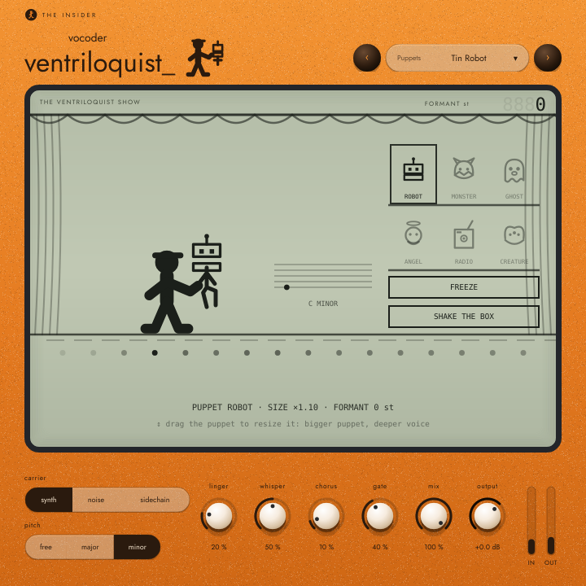

# vocoder ventriloquist_ — the insider

Plugin vocoder VST3 / AU (projet JUCE 8, C++17).
Le bonhomme est ventriloque : tu parles, sa marionnette répond avec tes mots dans une autre voix.



## Ce que fait le plugin

| Réglage | Où | Effet |
|---|---|---|
| **Marionnette** (6 têtes) | étagère dans l'écran | 6 algorithmes complets : ROBOT (vocoder classique net), MONSTER (formants graves, sous-octave, saturation), GHOST (voix soufflée, longue traîne, stéréo large), ANGEL (porteuse en chœur désaccordé, formants hauts), RADIO (bande 300–3400 Hz, 10 bandes, drive), CREATURE (bandes permutées + modulation en anneau) |
| **Taille** | faire glisser la marionnette ↕ | décalage des formants de −12 à +12 demi-tons (grande marionnette = voix plus grave) |
| **FREEZE** | bouton dans l'écran | fige l'enveloppe spectrale : la voyelle est tenue à l'infini |
| **SHAKE THE BOX** | bouton dans l'écran | tire au hasard une marionnette, une taille et des réglages |
| **carrier** | synth / noise / sidechain | porteuse : synthé interne, bruit blanc, ou n'importe quelle piste en sidechain |
| **pitch** | free / major / minor | sans MIDI, le synthé interne suit la hauteur de ta voix (détection YIN), libre ou calée sur la gamme (tonalité : paramètre *Key*, C par défaut). Avec des notes MIDI, le synthé joue les notes (8 voix) |
| **linger** | potard | traîne du banc de filtres : les mots restent en l'air (de 35 ms à ~2,5 s) |
| **whisper** | potard | consonnes : les « s », « t », « ch » passent en clair et le bruit remplace la porteuse sur les sons non voisés |
| **chorus** | potard | chorus stéréo sur la voix de la marionnette |
| **gate** | potard | expandeur déclenché par la voix : la marionnette se tait net quand tu te tais |
| **mix / output** | potards | mélange sec / traité, volume de sortie |

Dans l'écran, tout vient du vrai signal : la bouche de la marionnette suit le niveau de sortie, les bulles affichent la note chantée (ou « sss » sur les consonnes), la portée montre les notes quantifiées, et une rangée de **lampes de rampe** au bord de la scène s'allume bande par bande (une lampe = une bande du vocoder).

Côté qualité : bancs de filtres passe-bande d'ordre 4 en échelle logarithmique, suiveurs d'enveloppe par bande, **blanchiment de la porteuse** (chaque bande de la porteuse est normalisée, donc l'intelligibilité ne dépend pas du timbre de la porteuse), oscillateurs anti-aliasés (PolyBLEP), formant fractionnaire lissé, fondu de 15 ms aux changements de marionnette, **zéro latence**, MIDI à l'échantillon près. Moins de 3 % d'un cœur CPU au test.

## Obtenir le plugin

Ce dossier contient le code source. Il faut le compiler une fois pour obtenir `vocoder ventriloquist.vst3` (et `.component` sur Mac).

### Option A — sans rien installer (GitHub compile pour vous, Mac + Windows)

1. Créez un dépôt sur github.com et déposez-y tout le contenu de ce dossier.
2. Dans l'onglet **Actions**, cliquez sur « set up a workflow yourself » et collez le contenu
   du fichier `.github/workflows/build.yml` de ce dossier (caché par défaut sur Mac et Windows).
3. La compilation « Build vocoder ventriloquist » démarre toute seule.
4. Une fois terminée, téléchargez `VocoderVentriloquist-macOS` ou `VocoderVentriloquist-Windows` dans **Summary → Artifacts**.

### Option B — sur votre Mac

1. Installez les outils Apple : `xcode-select --install`
2. Installez CMake (cmake.org ou `brew install cmake`)
3. Double-cliquez sur `build_mac.command` (le plugin est installé automatiquement)

### Option C — sur Windows

1. Installez Visual Studio 2022 (« Développement Desktop en C++ ») et CMake
2. Double-cliquez sur `build_windows.bat`
3. Copiez `build\VocoderVentriloquist_artefacts\Release\VST3\vocoder ventriloquist.vst3` dans `C:\Program Files\Common Files\VST3\`

### Installer un plugin téléchargé (option A)

- **Mac** : copiez `vocoder ventriloquist.vst3` dans `~/Library/Audio/Plug-Ins/VST3/` et `vocoder ventriloquist.component`
  dans `~/Library/Audio/Plug-Ins/Components/`, puis levez la quarantaine dans le Terminal :
  `xattr -dr com.apple.quarantine ` suivi du fichier glissé depuis le Finder.
- **Windows** : copiez `vocoder ventriloquist.vst3` dans `C:\Program Files\Common Files\VST3\`.

## Utiliser dans Ableton Live

1. Pose le plugin sur ta piste de voix (micro en direct ou piste enregistrée).
2. **Sans rien d'autre**, la marionnette chante sur la hauteur de ta voix (pitch : *minor* par défaut, ou *free* pour suivre exactement).
3. **Pour jouer des accords** : crée une piste MIDI, règle sa sortie « MIDI To » sur la piste de voix → *vocoder ventriloquist*, et joue.
4. **Pour une porteuse externe** : choisis *sidechain* et sélectionne la piste source dans l'entrée sidechain du plugin (en haut du plugin dans Live).

## Police

L'interface utilise la police placée dans `Assets/Fonts` (Jost, licence libre OFL), embarquée dans le plugin.
Les chiffres de l'écran utilisent la police à chasse fixe du système ; pour retrouver exactement la préviz,
ajoutez `ShareTechMono-Regular.ttf` (Google Fonts, OFL) dans `Assets/Fonts`.

## Tester le moteur audio sans DAW

`Tests/render_test.cpp` fabrique une voix de synthèse, la passe dans les 6 marionnettes et les 3 porteuses,
vérifie niveaux, NaN et suivi de hauteur, et écrit des WAV :

```bash
cmake -B build -DVQ_BUILD_TESTS=ON && cmake --build build --target vq_render_test
./build/vq_render_test dossier_de_sortie
```

## Structure

```
CMakeLists.txt
Source/dsp/VentriloquistEngine.h   moteur audio (C++ pur, sans dépendance)
Source/PluginProcessor.*           paramètres, bus sidechain, MIDI, presets, état
Source/PluginEditor.*              fenêtre 720×720 : en-tête, potards, sélecteurs, vumètres
Source/gui/TheatreView.*           l'écran LCD : théâtre, marionnettes, bulles, étagère, freeze/shake
Source/gui/Style.h                 couleurs, polices, dessin du bonhomme, grain de la coque
Source/Presets.h                   10 presets d'usine
Assets/Fonts/                      police embarquée (Jost)
Tests/render_test.cpp              test hors ligne du moteur
```

## Avant de vendre

- **Licence JUCE** : vérifie les conditions de la licence JUCE pour un produit commercial (offre gratuite sous un certain chiffre d'affaires, sinon licence payante, ou publication du code en AGPL).
- **Mac** : signer et notariser le plugin avec un compte Apple Developer, sinon Gatekeeper le bloque chez tes clients.
- **Windows** : un installeur (Inno Setup par exemple) et idéalement une signature de code.
- **Codes plugin** : `Insd` (fabricant) et `Vntq` (plugin) sont des codes provisoires ; garde-les identiques une fois le plugin publié, sinon les projets de tes clients ne le retrouveront plus.
